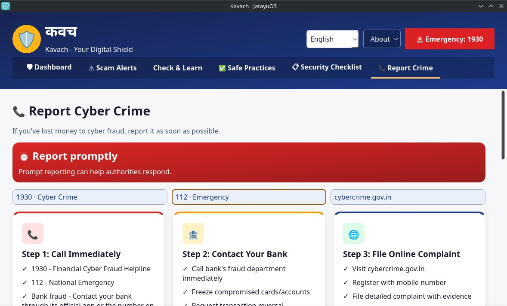

# Jatayu Kavach (कवच)

Kavach is an offline digital safety and scam awareness app for **JatayuOS** and Indian households. Created by **Anup Kumar Yadav**, it uses native **PySide6 / Qt Widgets** and is packaged for **Debian 13** and **KDE Plasma 6**.



## Inside Kavach

- **Dashboard** with shortcuts to firewall settings, system updates, and backups.
- **Scam Alerts** with 15 guides on common scams in India.
- **Check & Learn** with 28 illustrated exercises, search, topic filters, and answer feedback.
- **Safe Practices** with guidance on UPI, passwords, suspicious messages, and checking `.bank.in` addresses.
- **Security Checklist** with progress saved on your device.
- **Report Crime** with in-app dial prompts for 1930 and 112, and a link to the official reporting portal.

The app supports English and 22 Indian languages offline. Machine-translated guidance is available as a preview while fluent-speaker review is pending.

## Installation

[**Download for JatayuOS (.deb)**](https://github.com/jatayuos4u/jatayu-kavach/releases/download/v0.3.5/jatayu-kavach_0.3.5-1_all.deb)

Open the downloaded package with your package installer, then search for **Jatayu Kavach (Standalone)** in the application menu.

The [v0.3.5 release page](https://github.com/jatayuos4u/jatayu-kavach/releases/tag/v0.3.5) includes `SHA256SUMS` and the complete `jatayu-kavach_0.3.5-1_source.zip`. Use the named archive for the released source. GitHub’s automatic archives for that tag reflect the repository’s initial README commit.

## Build on Debian 13

From a checkout, run the following with Python 3, `dpkg-deb`, and the standard Debian shell utilities available.

```sh
./build.sh ../kavach-packages
```

The script validates the language catalogs and writes `../kavach-packages/jatayu-kavach_0.3.5-1_all.deb`. The package declares its PySide6 and font runtime dependencies. The standalone app has a separate desktop entry from the Kavach app bundled with JatayuOS.

## Disclaimer

Kavach is an independent educational app. It cannot verify whether a message or website is safe, file a complaint on your behalf, or recover funds. Use the official channels listed in **Report Crime**.

## Licence and credits

Kavach software is licensed under [GPL-3.0-or-later](LICENSE). The JatayuOS name and icon have separate branding terms. Preview translations use AI4Bharat IndicTrans2, and the practice illustrations were created with OpenAI ImageGen.

[Official JatayuOS website](https://jatayuos.in/)
